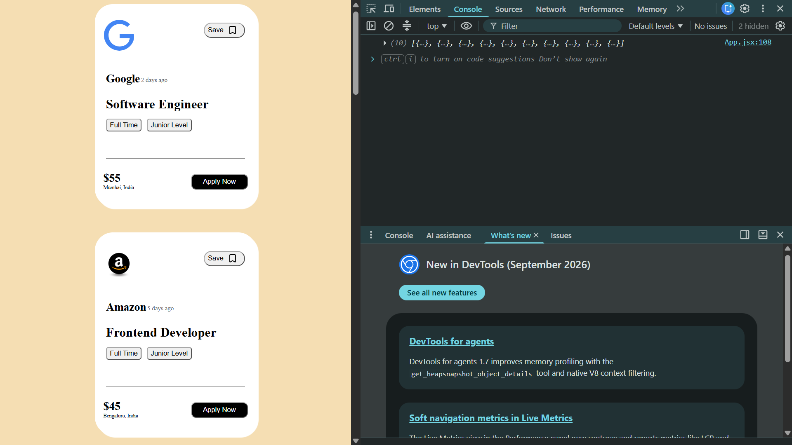
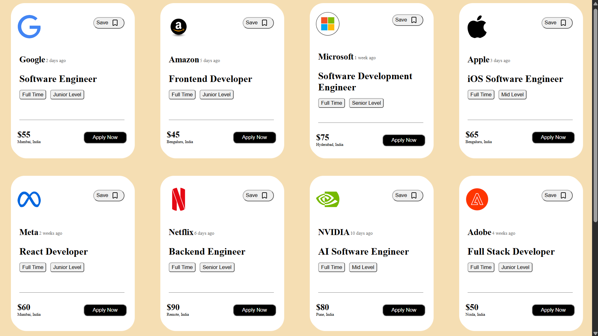

# React Cards Project 
A simple react project demonstrating reusable components and props by displaying job openings 
in a card based layout .

Features 
Reusable react components
props for passing data between components
Dynamic rendering of card information 
Responsive card based user interface

Tech stack 
React.js
JavaScript 
HTML5
CSS3
Vite

Getting started 
1.Clone the repository
git clone https://github.com/Sandesh-9890/props-mini-project.git

2. Navigate to the project directory
cd props-mini-project

3. Install dependencies
npm install

4. Start the development server
npm run dev

Open the local URL displayed in your terminal.

Author
Sandesh Namdev Rasal

License
This project is intended for learning and educational purposes.

## Screenshots

### Main Page

